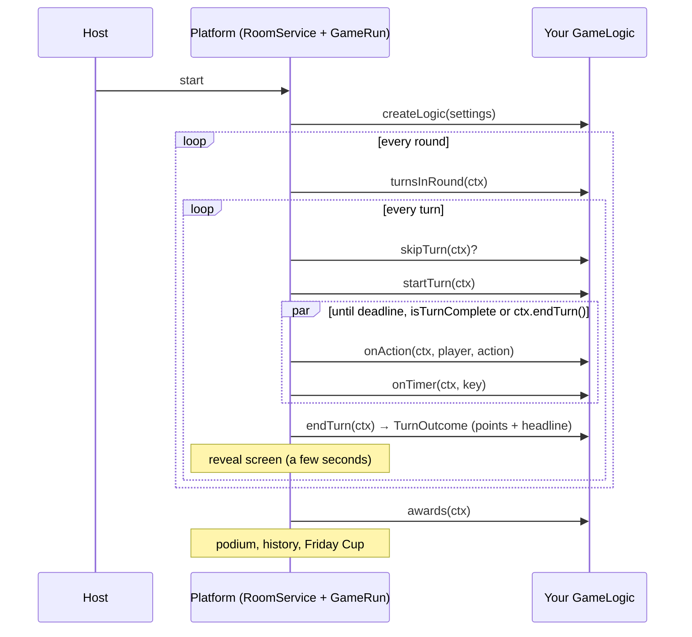

# Adding a game

Every game lives in **one folder**: `games/<id>/`. The platform discovers it automatically — no
registry to edit, no platform code to touch.

```text
games/my-game/
├── README.md                 rules, scoring, settings, design notes
├── backend/                  Java module (auto-included by backend/settings.gradle)
│   └── src/
│       ├── main/java/com/example/funfridaygame/games/mygame/
│       │   ├── MyGame.java          @FunFridayGame — metadata, settings, createLogic()
│       │   ├── MyGameLogic.java     the rules (GameLogic)
│       │   └── MyGameView.java      what browsers receive (records)
│       ├── main/resources/…          word lists, questions, … (optional)
│       └── test/java/…/MyGameTest.java   scenario tests with GameHarness
├── frontend/                 Angular UI (auto-registered as a lazy chunk)
│   ├── index.ts                     export default defineGameUi({ component: MyGameComponent })
│   ├── my-game.component.{ts,html,scss}
│   └── my-game.types.ts             TypeScript mirror of the view records
└── e2e/
    └── my-game.spec.ts       Playwright: plays a full game with two browsers
```

Start from the template:

```bash
npm run new-game -- my-game "My Game" "🎯"
```

The id is the folder name: kebab-case, unique, stable (it is stored in the game history).

## How a game runs



After every change the platform calls `view(ctx, viewer)` once per player and once for spectators
and pushes the result to each browser as part of its personal room snapshot. **Browsers only ever
see what `view` returns** — hide answers and other players' secrets there.

The platform takes care of rooms, joining, reconnecting, host changes, spectators, timers, the
reveal screen, scores (totals never drop below 0), the podium (ties share a place), awards,
history, the Friday Cup and rate limiting. A game only implements its rules and its screen.

## Backend

### 1. The definition

```java
@FunFridayGame // a Spring @Component: discovered automatically
public class MyGame implements GameDefinition {

    @Override
    public GameInfo info() {
        return new GameInfo(
                "my-game",                       // = folder name
                "My Game",
                "One sentence that sells it.",
                "🎯",
                2, 12,                           // min/max players
                GameInfo.Difficulty.EASY,
                List.of("Rule one.", "Rule two.", "How points work."));
    }

    @Override
    public List<SettingDef> settings() {
        return List.of(
                CommonSettings.rounds(3, 1, 3, 5),          // read by the platform
                CommonSettings.roundDuration(30, 15, 30, 60), // default turn deadline (optional)
                SettingDef.selectInt("size", "Board size", 4, null, 4, 6),
                SettingDef.toggle("hints", "Hints", true).withHelp("Shown after 15 s"));
    }

    @Override
    public List<String> validate(GameSettings settings) {  // optional cross-field rules
        return List.of();
    }

    @Override
    public GameLogic createLogic(GameSettings settings) {
        return new MyGameLogic(settings.getInt("size"), settings.getBoolean("hints"));
    }
}
```

The settings form in the UI is generated from `settings()`: the host page, the lobby and the
"change game" dialog always offer exactly these options, and the server validates every value
(type, allowed options, min/max) before your game sees it. `SettingDef` types: `select`,
`selectInt`, `number`, `toggle`.

Games without fixed-length turns (e.g. a reaction game that schedules its own signals) simply leave
out `roundDuration` and call `ctx.setDeadline(...)` in `startTurn`.

### 2. The logic

```java
final class MyGameLogic implements GameLogic {

    record Answer(@NotBlank @Size(max = 40) String text) {} // action payload, validated

    private final Map<String, String> answers = new HashMap<>();
    private boolean revealed;

    @Override
    public void startTurn(GameContext ctx) {
        answers.clear();
        revealed = false;
        // pick a challenge with ctx.random(); never use new Random() or System.currentTimeMillis()
    }

    @Override
    public void onAction(GameContext ctx, PlayerInfo player, Action action) {
        if (!"answer".equals(action.type())) {
            throw new InvalidActionException("Unknown action " + action.type());
        }
        Answer answer = action.payload(Answer.class); // throws InvalidActionException if invalid
        if (answers.containsKey(player.id())) {
            throw new InvalidActionException("You already answered"); // shown to the player
        }
        answers.put(player.id(), answer.text());
    }

    @Override
    public boolean isTurnComplete(GameContext ctx) {
        return ctx.activePlayers().stream().allMatch(p -> answers.containsKey(p.id()));
    }

    @Override
    public TurnOutcome endTurn(GameContext ctx) {
        revealed = true;
        TurnOutcome.Builder outcome = TurnOutcome.builder().headline("The answer was …");
        answers.forEach((playerId, text) -> outcome.add(playerId, 10));
        return outcome.build();
    }

    @Override
    public Object view(GameContext ctx, Viewer viewer) {
        return new MyGameView(revealed, viewer.isSpectator() ? null : answers.get(viewer.playerId()));
    }

    @Override
    public Object debugState(GameContext ctx) { // e2e tests only
        return Map.of("answer", "…");
    }
}
```

Rules of thumb:

| Topic        | Do                                                                                                                                                                                                                                                                                                                                                                                                             |
| ------------ | -------------------------------------------------------------------------------------------------------------------------------------------------------------------------------------------------------------------------------------------------------------------------------------------------------------------------------------------------------------------------------------------------------------- |
| Time         | `ctx.now()`, `ctx.deadline()`, `ctx.remainingMillis()`, `ctx.turnStartedAt()` — never the system clock (tests use virtual time).                                                                                                                                                                                                                                                                               |
| Randomness   | `ctx.random()` (seeded in tests).                                                                                                                                                                                                                                                                                                                                                                              |
| Timers       | `ctx.schedule("key", Duration)` → `onTimer(ctx, "key")`; timers belong to the turn and are cancelled when it ends. `ctx.setDeadline(Duration)` moves the turn end (e.g. a "choose a word" sub-phase).                                                                                                                                                                                                          |
| Ending early | Return `true` from `isTurnComplete` (checked after every action/timer/roster change) or call `ctx.endTurn()`. Count only `ctx.activePlayers()` (connected players) so a disconnected player never blocks a turn.                                                                                                                                                                                               |
| Leaving      | `onPlayerLeft` is called when someone leaves for good; `skipTurn` lets you skip e.g. a departed drawer's turn.                                                                                                                                                                                                                                                                                                 |
| Rejecting    | Throw `InvalidActionException("message")` — the sender sees the message, nothing changes.                                                                                                                                                                                                                                                                                                                      |
| Payloads     | Records with Bean Validation (`@NotNull`, `@Size`, `@Min`, …) and `action.payload(Type.class)`.                                                                                                                                                                                                                                                                                                                |
| Views        | Return records (or maps). `null` fields are omitted from the JSON. Hide secrets until the reveal; spectators get `Viewer.spectator()`.                                                                                                                                                                                                                                                                         |
| Live data    | `ctx.stream(type, payload)` sends a public event to everybody immediately (e.g. drawing strokes); `ctx.sendTo(playerId, type, payload)` a private one ("you're close!"). Call `ctx.suppressUpdate()` in `onAction` when the action changed nothing the views show (no snapshot is sent). State that late joiners need must be in the view or re-sent on request (e.g. a `sync` action answered with `sendTo`). |
| Rate         | Players may send about 20 actions per second (burst 40); batch high-frequency input (e.g. strokes every ~80 ms).                                                                                                                                                                                                                                                                                               |
| Errors       | Exceptions in your code are contained and logged; the room keeps running.                                                                                                                                                                                                                                                                                                                                      |
| Content      | Curated lists in `src/main/resources` (no AI, no network).                                                                                                                                                                                                                                                                                                                                                     |
| Scoring      | `TurnOutcome.builder().add(playerId, points).headline("…")`; negative points are allowed, totals never drop below 0.                                                                                                                                                                                                                                                                                           |
| Awards       | `awards(ctx)` → e.g. `new Award("⚡", "Fastest fingers", playerId, "182 ms")`.                                                                                                                                                                                                                                                                                                                                 |

Threading: all callbacks of a room run one at a time — no locks needed.

### 3. Scenario tests

`GameHarness` runs your game through the real engine without Spring or WebSockets, with virtual
time and a seeded random generator:

```java
GameHarness game = GameHarness.of(new MyGame())
        .players("alice", "bob")           // player ids = names
        .settings(Map.of("rounds", 1))
        .seed(42)
        .start();

game.act("alice", "answer", Map.of("text", "42"));
assertThat(game.reject("alice", "answer", Map.of("text", "again")).getMessage())
        .contains("already");
game.advanceSeconds(30);                    // deadline passes → reveal
assertThat(game.phase()).isEqualTo(RunPhase.REVEAL);
assertThat(game.lastTurn().points()).containsEntry("alice", 10);
game.finishGame();
assertThat(game.result().standings().getFirst().player().id()).isEqualTo("alice");
```

Useful methods: `view(id)`, `spectatorView()`, `debugState()`, `advance(Duration)`, `finishTurn()`,
`nextTurn()`, `disconnect(id)`, `reconnect(id)`, `leave(id)`, `scores()`, `streamed()`,
`privateEvents(id)`, `remainingMillis()`.

Run: `cd backend && ./gradlew :games:my-game:test`.

## Frontend

### 1. The entry point

```ts
// games/my-game/frontend/index.ts
import { defineGameUi } from '@ff/sdk';
import { MyGameComponent } from './my-game.component';

export default defineGameUi({ component: MyGameComponent });
```

`scripts/generate-game-registry.mjs` (run automatically by `npm start` / `npm run build`) turns
every `games/*/frontend/index.ts` into a lazy chunk.

### 2. The component

```ts
import { ChangeDetectionStrategy, Component, computed, signal } from '@angular/core';
import { injectGameApi, PlayerChip, TimerRing } from '@ff/sdk';
import { MyGameView } from './my-game.types';

@Component({
  selector: 'ff-my-game',
  changeDetection: ChangeDetectionStrategy.OnPush,
  imports: [PlayerChip],
  templateUrl: './my-game.component.html',
  styleUrl: './my-game.component.scss',
})
export class MyGameComponent {
  protected readonly api = injectGameApi<MyGameView>();
  protected readonly view = this.api.view; // Signal<MyGameView | null>
  protected readonly canAnswer = computed(
    () => this.api.isPlaying() && this.api.phase() === 'PLAYING',
  );
  protected readonly error = signal<string | null>(null);

  protected async answer(text: string) {
    const result = await this.api.send('answer', { text }, { quiet: true });
    this.error.set(result.ok ? null : result.message);
  }
}
```

`GameApi` (all signals reflect the latest server snapshot):

| Member                              | What it is                                                              |
| ----------------------------------- | ----------------------------------------------------------------------- |
| `view()`                            | your view for this browser (`null` before the first turn)               |
| `phase()` / `revealing()`           | `PLAYING` during a turn, `REVEAL` while results are shown               |
| `meId()`, `me()`, `isPlaying()`     | who this browser is; spectators have `isPlaying() === false`            |
| `players()`, `player(id)`           | players of this game with `name`, `avatar`, `color`, `score`, `online`  |
| `progress()`                        | `round`, `totalRounds`, `turn`, `turnsInRound`                          |
| `settings()`                        | the host's settings                                                     |
| `timeLeftMs()`, `phaseDurationMs()` | server-synchronised countdown of the turn/reveal                        |
| `lastTurn()`                        | points and headline of the turn being revealed                          |
| `send(type, payload, {quiet})`      | action → `Promise<ActionResult>`; rejected actions toast unless `quiet` |
| `sendFast(type, payload)`           | fire-and-forget for high-frequency actions (strokes, progress)          |
| `stream$`, `events$`                | public stream events / private events for this player                   |
| `now()`                             | server time (e.g. to measure reaction times)                            |

The platform already shows the game name, round counter, timer, scoreboard (with the turn's
points during the reveal) and a reveal banner with your `headline`, so the component only renders
the game itself.

SDK building blocks: `<ff-player-chip [player]="p" size="sm">`, `<ff-timer-ring>`,
`[ffCountUp]="score"`, `ffAutofocus` / `[ffAutofocus]="condition"`, `formatDuration()`, and the
icon set (`<mat-icon svgIcon="send" />`, see `frontend/src/app/core/icons.ts`). Angular Material
components can be used directly.

### 3. Look and layout

- Desktop only. The component's host fills the stage, which has a fixed size: **never let the page
  scroll** — scale content to the available space (flex/grid, `min-height: 0`).
- Use the design tokens instead of hard-coded colours: Material's `--mat-sys-*` variables and the
  platform's `--ff-*` tokens (`--ff-success`, `--ff-warning`, `--ff-danger`, `--ff-radius`,
  `--ff-text-muted`, …). Each player has a colour (`player.color`) — use it for their marks.
- Motion: the global classes `ff-enter-pop`, `ff-enter-fade-up`, `ff-leave-fade`, `ff-shake`,
  `ff-pulse` (scale only) work with Angular's `animate.enter` / `animate.leave`.
  `prefers-reduced-motion` is respected globally.
- Spectators (`!api.isPlaying()`) see the same component without input controls.
- Add `data-testid` attributes to controls the e2e test needs.

## End-to-end test

```ts
// games/my-game/e2e/my-game.spec.ts
import { expect, peek, setUpRoom, startGame, test, waitForPhase } from '../../../e2e/fixtures';

test('a full game', async ({ players, request }) => {
  const [ann, bob] = await players('Ann', 'Bob');
  const code = await setUpRoom([ann, bob], 'my-game', { rounds: '1' }); // option labels
  await startGame(ann, request, code);
  const { state } = await peek<{ answer: string }>(request, code); // your debugState()
  // … play with ann.page / bob.page …
  await waitForPhase(request, code, 'FINISHED');
  await expect(ann.page.getByTestId('results-headline')).toContainText('You won');
});
```

Run: `npm run build && npm run e2e -- games/my-game` (the e2e profile uses a 1 s countdown and a
1.5 s reveal).

## Checklist

- [ ] `info()` id equals the folder name; rules explain scoring in one line each
- [ ] Settings include `CommonSettings.rounds`; impossible combinations rejected in `validate`
- [ ] No secrets in views before the reveal; spectators handled
- [ ] Turns end early when everyone is done; disconnected players never block a turn
- [ ] Scenario tests cover scoring, early end, rejected actions, a player leaving
- [ ] UI fits the stage without scrolling; uses tokens and player colours
- [ ] e2e spec plays a full game
- [ ] `games/my-game/README.md` documents rules, scoring and settings
