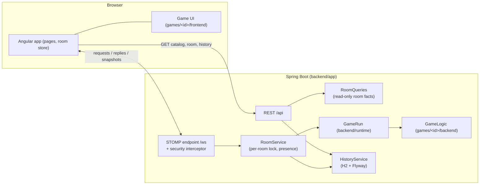
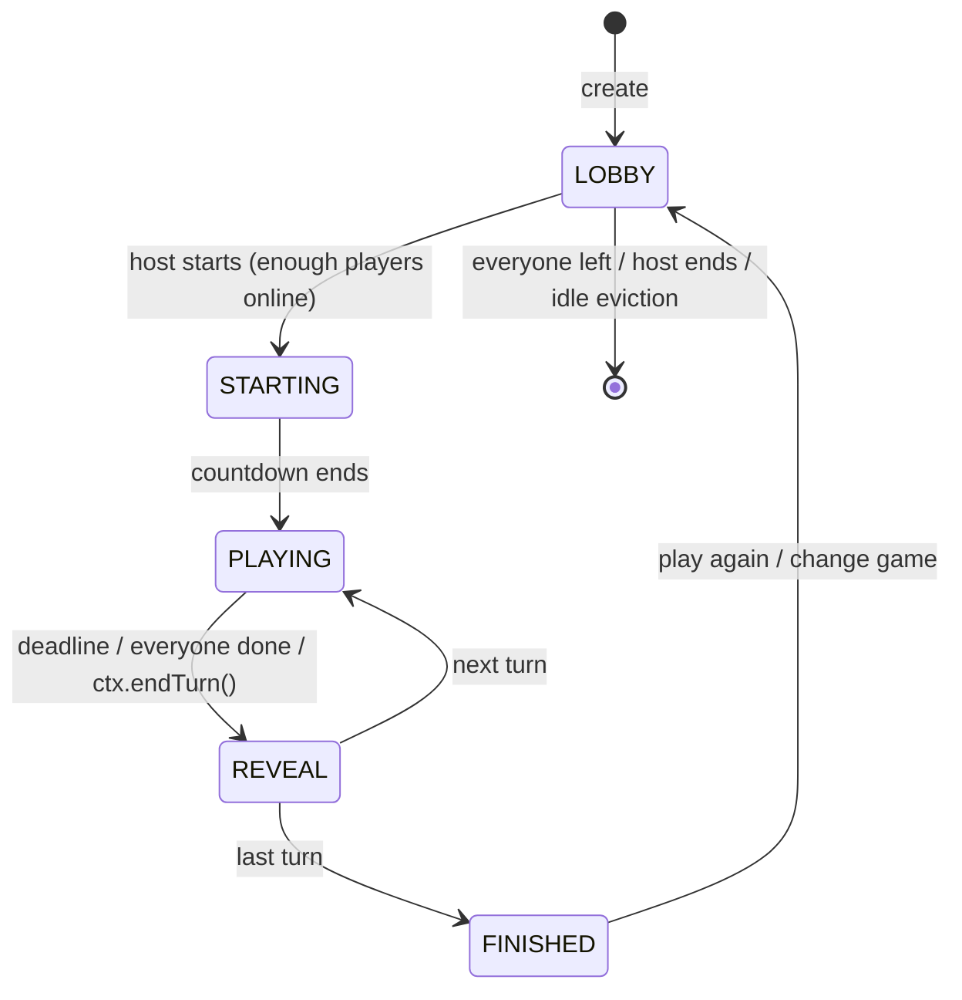

# Architecture

Fun Friday is a single deployable: a Spring Boot server that serves the Angular app, a REST API
for read-only data and a STOMP-over-WebSocket API for everything live. Games are plug-ins.

## Modules

| Module                | Responsibility                                                                                                                                                  | Depends on                                            |
| --------------------- | --------------------------------------------------------------------------------------------------------------------------------------------------------------- | ----------------------------------------------------- |
| `backend/sdk`         | The contract for games: `GameDefinition`, `GameLogic`, `GameContext`, `SettingDef`, `TurnOutcome`, `Award`, views                                               | Spring context (annotation only), Bean Validation API |
| `backend/runtime`     | `GameRun`: drives one game (rounds → turns → reveal → finish), timers with turn tokens, score totals, ranking with ties, settings validation, error containment | sdk                                                   |
| `backend/testkit`     | `GameHarness`: runs a game with virtual time and a seeded random generator                                                                                      | runtime                                               |
| `games/<id>/backend`  | One game's rules, views and content                                                                                                                             | sdk (+ testkit for tests)                             |
| `backend/app`         | Rooms, membership, presence, host migration, STOMP + REST API, snapshots, history, metrics                                                                      | runtime, every game module                            |
| `frontend`            | Shell pages, realtime client, room store, frontend SDK, theme                                                                                                   | Angular, Material, stompjs                            |
| `games/<id>/frontend` | One game's screen                                                                                                                                               | `@ff/sdk`                                             |
| `e2e`                 | Playwright platform specs and helpers; game specs live in `games/<id>/e2e`                                                                                      | Playwright                                            |

Game modules are discovered automatically: `backend/settings.gradle` includes every
`games/*/backend`, the app depends on all of them, and Spring finds each `@FunFridayGame`. On the
client, `scripts/generate-game-registry.mjs` turns every `games/*/frontend/index.ts` into a lazy
chunk. Folders starting with `_` (the template) are skipped. `-PffGames=a,b` and `FF_GAMES=a,b`
build a subset.

## Real-time protocol

One STOMP connection per tab (SockJS fallback, 10 s heart-beats, exponential reconnect).

| Direction       | Destination                                                                                                            | Content                                                                                                               |
| --------------- | ---------------------------------------------------------------------------------------------------------------------- | --------------------------------------------------------------------------------------------------------------------- |
| client → server | `/app/rooms/{create, join, resume, leave, kick, settings, ready, become-player, start, play-again, end, action, ping}` | request with optional `requestId`                                                                                     |
| server → client | `/user/queue/reply`                                                                                                    | `Reply {requestId, ok, error, message, data}` for every request (success replies are skipped for requests without id) |
| server → client | `/user/queue/room`                                                                                                     | the full, personal `RoomSnapshot` after every change (coalesced ~50 ms for bursts of actions)                         |
| server → client | `/user/queue/events`                                                                                                   | `KICKED`, `ROOM_CLOSED`, `REPLACED`, `HOST_CHANGED`, private game events                                              |
| server → client | `/topic/rooms/{code}/stream`                                                                                           | public high-frequency game events (e.g. strokes), with a sequence number                                              |

The schemas are generated from the Java records: `docs/openapi.json` (written by
`ApiContractTest`) → `frontend/src/app/core/api/schema.generated.ts` (`npm run generate:api`).
The channels are described in [asyncapi.yaml](asyncapi.yaml).

### Identity and security

- On CONNECT the `StompSecurityInterceptor` assigns a random principal to the connection. Create,
  join and resume bind that principal to a member; every later command is resolved from the
  principal — never from names in payloads.
- Subscriptions are limited to the caller's own `/user/queue/*` destinations and the stream of the
  room they are in; clients may only send to `/app/**`.
- A secret per-member token (returned once on join) lets the same tab resume after a refresh or a
  dropped connection. If a second tab resumes the same seat, the first gets `REPLACED`.
- Names are validated on the server (length, characters, unique per room); every game action is
  validated by the game and rate-limited per member (token bucket).
- Views are computed per viewer (`GameLogic.view(ctx, viewer)`), so secrets (answers, other
  players' guesses, the drawer's word) never reach other browsers.

### Room life cycle

Presence: a closed WebSocket marks the member offline; after the grace period (30 s) they are
removed. Offline players never block a turn (`GameContext.activePlayers()`), the host role moves to
the next online player, rooms close when empty and idle rooms are evicted.

### Concurrency

Each room has its own lock. Commands, timers and disconnects of one room run under that lock, one
at a time; different rooms run in parallel on virtual threads. Timers carry a turn token so a timer
scheduled for an old turn can never fire into a new one.

## Frontend

- **Zoneless Angular** with signals: `RoomStore` holds the latest snapshot and derives everything
  else (`computed` with structural equality so unchanged parts don't re-render).
- `RealtimeService` owns the connection: request/reply correlation with timeouts, automatic
  re-subscription, and a session gate so nothing is sent before the seat is resumed after a
  reconnect.
- `ClockService` estimates the server clock offset (NTP-style pings) so countdowns are right on
  every machine.
- Pages are lazy-loaded; each game UI is its own chunk, hosted by the stage with an injected
  `GameApi` (signals for view, players, timer; `send`/`sendFast`; streams).
- Look and feel: Material 3 theme (`mat.theme`, dark), design tokens (`--ff-*`), a small motion
  system (`animate.enter`, view transitions) that honours `prefers-reduced-motion`, inline SVG icons
  (no CDN), desktop-first layouts that fit the window.

## Persistence

H2 (file database in `FF_DATA_DIR`) with Flyway migrations and Spring Data JDBC:

- `GAME_RECORD` — one row per finished game (room, game, settings, start/end).
- `GAME_RECORD_PLAYER` — per-player score, placement and Friday Cup points.

Writes happen off the room lock on a virtual thread. The hall of fame (`/history`) shows the
leaderboard (Friday Cup points over 7/30/365 days) and recent games. Live rooms stay in memory.

## Observability

- Logs carry the room code (`%X{room}` via MDC).
- Actuator: `/actuator/health` (used by Docker and Render), `/actuator/metrics` with
  `funfriday.rooms.*` and `funfriday.games.*` counters/gauges.

## Testing strategy

Functional tests only (see `implementation-plan.md`):

| Level      | Tool                                   | What                                                                                                                                 |
| ---------- | -------------------------------------- | ------------------------------------------------------------------------------------------------------------------------------------ |
| Game rules | JUnit + `GameHarness`                  | each game through the real runtime with virtual time                                                                                 |
| Server     | Spring Boot tests + real STOMP clients | room flows, resume, host migration, validation, spectators, API contract                                                             |
| Product    | Playwright, several browser contexts   | every page and every game end to end against the packaged jar (`e2e` profile with short timers and a test endpoint for secret state) |
